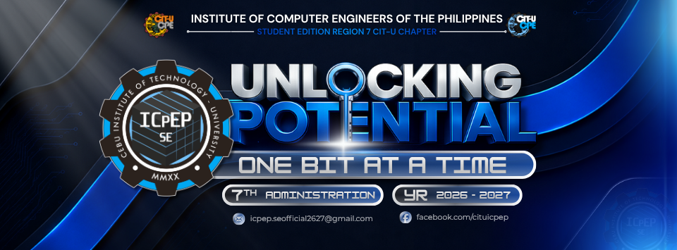

# CpE Starter Toolkit

**Set up. Start coding.** A beginner-friendly programming setup guide from the ICpEP.SE CIT-U community, led by the Research and Development Committee.



> **V1 review draft · v0.1.0.** This is an implementation of a proposed toolkit, not a faculty-approved release. MSYS2 UCRT64, Python 3.14, supported device requirements, and instructions still need technical confirmation and Windows pilot testing. [See review status](docs/review-status.md).

## What is here

- Six guided steps: readiness, VS Code, C/C++, Python, Git/GitHub, and running verification programs.
- Brief macOS notes, troubleshooting, official download links, and a beginner learning roadmap.
- Search across guide text, copyable code, optional browser-local progress, and an interactive readiness checklist.
- An automatically generated Markdown guide, a print / Save as PDF view, and a ZIP of sample source files.
- Markdown-first contributions, issue and PR templates, automated checks, and pilot / turnover documentation.

No student accounts, backend, analytics, or database are required. The site is built as static HTML with Astro and TypeScript. Content stays readable without JavaScript. Search and saved checkmarks require it. Fonts are self-hosted.

## Run locally

Install **Node.js 24** (including npm) and Git. Then:

```sh
git clone https://github.com/SeanixReal/icpep-starter.git
cd icpep-starter
npm ci
npm run dev
```

Open the local address printed by Astro, usually `http://127.0.0.1:4321`. On Windows, if PowerShell blocks the `npm.ps1` wrapper, use `npm.cmd ci` and `npm.cmd run dev`; you do not need to change your execution policy.

```sh
npm run check    # Astro, TypeScript, and content schema checks
npm test         # Progress, search, source consistency, downloads, base-path checks
npm run build   # Generate downloads, build HTML, check local links and anchors
npm run preview # Serve the production build locally
```

The lockfile is committed. Use `npm ci` for reproducible setup. Use `npm install` only when intentionally changing dependencies, and include the updated lockfile.

## Contribute, even if you are new

You can improve a sentence, describe a setup problem, test a guide, or help with the website. Start with [CONTRIBUTING.md](CONTRIBUTING.md). Browser-only content edits are welcome: open a guide in `src/content/guides/`, use GitHub's edit action, and propose a pull request from a fork.

| I want to… | Start here |
| --- | --- |
| Fix or write a setup guide | [`src/content/guides/`](src/content/guides/) and [content guidance](docs/content-guide.md) |
| Change layout or behavior | [`src/layouts/`](src/layouts/), [`src/styles/`](src/styles/), [`src/scripts/`](src/scripts/) |
| Test with beginners | [Pilot testing](docs/pilot-testing.md) |
| Review software choices | [Technical review status](docs/review-status.md) |
| Understand how it works | [Architecture and diagrams](docs/architecture.md) |
| Publish or hand it over | [Deployment](docs/deployment.md) and [maintenance](docs/maintenance.md) |
| See what changed | [Changelog](CHANGELOG.md) |
| Inspect completed checks and their limits | [Implementation verification](docs/verification.md) |

Please document new features and update relevant diagrams throughout development. Never publish student records or credentials in issues, commits, or screenshots.

## Hosting status

The repository is ready to share. Public student launch is still pending review. A **manual** GitHub Pages workflow is included; nothing deploys merely because `main` receives a push. See [deployment instructions](docs/deployment.md). Base paths are configured through `SITE_BASE`, so the site can move into the future CpE Digital Hub without rewriting guide links.

## Project context and credits

Based on the CpE Starter Toolkit proposal for AY 2026–2027 supplied by the project owner. Proposed scope: Windows first, brief macOS notes, independent student pilot testing, annual review, and later integration into the CpE Digital Hub. The source proposal's goals are not represented as completed outcomes.

The owner supplied the ICpEP.SE chapter logo, administration banner, and brand reference. Original code and original toolkit text use the [MIT license](LICENSE). Institutional marks and third-party assets retain their respective rights; see [asset provenance](docs/assets.md). This draft uses Unbounded and Manrope because the HK Modular font files were not supplied.
