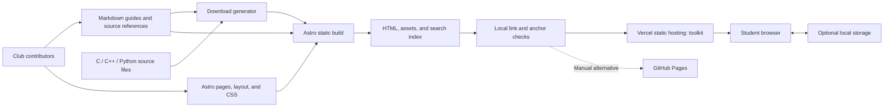
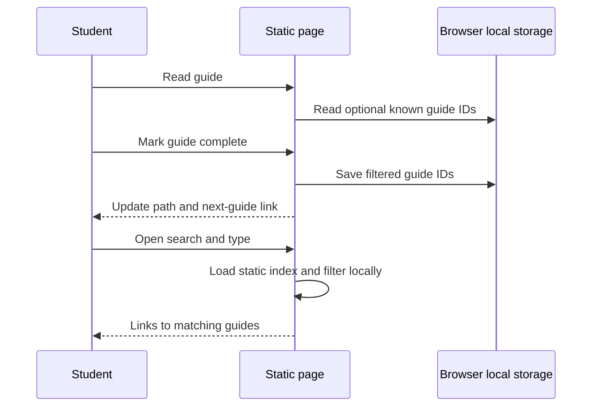

# Architecture

## The short version

Astro turns typed Markdown content and shared components into static HTML. A small browser script adds optional search and personal checkmarks. There is no server database, student account, or analytics integration.

Vercel hosts the toolkit at the site root. The connected GitHub repository can trigger production builds from `main` and preview builds from other branches. `vercel.json` runs type/content checks, tests, and the static build before publication. CLI deployments use the same configuration. The manually dispatched GitHub Pages workflow remains an alternative. Hosting does not change the proposed status of the instructional content.

## Source map

| Location | Responsibility |
| --- | --- |
| `src/content/guides/` | Editable instructional Markdown and official references |
| `src/content.config.ts` | Required frontmatter schema and content loader |
| `src/layouts/Base.astro` | Shared shell, review notice, search dialog, metadata, and fonts |
| `src/components/` | Navigation and small consistent SVG icons |
| `src/pages/` | Static routes, rendered guides, print view, and search index endpoint |
| `src/styles/global.css` | Shared tokens, responsive layout, focus, and print styles |
| `src/scripts/toolkit.ts` | Progressive browser interactions |
| `src/lib/` | Site links, known progress identifiers, parsing, and search ranking |
| `public/brand/` | Owner-supplied logo and banner, with provenance |
| `public/downloads/` | Canonical sample sources; generated Markdown and ZIP are ignored |
| `scripts/` | Portable download preparation, Markdown base-path rewriting, build checks |
| `tests/` | Meaningful progress, content, search, download, and path regressions |
| `vercel.json`, `.vercelignore` | Checked static deployment and upload exclusions; account-specific `.vercel/` metadata is ignored |

## Routes

- `/`: overview and six-step path.
- `/guides/readiness/`, `/editor/`, `/c-cpp/`, `/python/`, `/git-github/`, `/verify/` under `/guides/`: ordered setup content.
- `/guides/macos/`: separate platform notes.
- `/troubleshooting/`, `/roadmap/`, `/downloads/`, `/about/`: supporting content.
- `/print/`: all guides with print CSS.
- `/search.json`: generated static guide index.
- `/404.html`: generated not-found page.

## Browser behavior

Storage keys are `cpe-toolkit:progress:v1` and `cpe-toolkit:readiness:v1`. Only checkmark identifiers are stored. Corrupt progress is discarded, unknown guide identifiers are ignored, and unavailable storage must not stop reading. Storage events refresh progress across tabs. A site-origin change will naturally give the new site a separate storage area.

Search uses text content and DOM `textContent` when rendering results. It does not interpret a search query as HTML. Code copying reports permission failure and leaves manual selection available. The mobile navigation preserves a non-JavaScript fallback and traps keyboard focus while expanded.

Guide completion uses the button label alone. Readiness checkboxes have one label each; their live status appears after interaction with a count and a storage warning only when needed. These copy changes do not alter storage keys, completion semantics, or the no-JavaScript reading path. Guide frontmatter uses the typed `proposed` status.

## Portability and migration

`url()` uses Astro's configured base URL. The Markdown rehype plugin prefixes internal guide links during build. Both layers are needed for repository hosting at `/icpep-starter/` and future migration into a Digital Hub subpath. An automated build check validates local targets and anchors after compilation.

`SITE_URL` explicitly sets the site origin. Otherwise a Vercel build uses `VERCEL_PROJECT_PRODUCTION_URL` with HTTPS; non-Vercel builds fall back to the GitHub Pages origin. `SITE_BASE` defaults to `/`, so Vercel serves the guide routes, search index, and downloads from the root. Trailing-slash routing follows Astro's directory output, while file URLs retain their extensions. No adapter or server runtime is required.

Astro 7 uses the separately installed `@astrojs/markdown-remark` compatibility processor for this rehype plugin. Do not remove it without replacing and testing base-path rewriting.

When adding, removing, or renaming a setup guide, update its frontmatter order, `src/lib/site.ts`, known IDs in `src/lib/progress.mjs`, and the related tests. Plan storage migration if identifiers change. Document any new network requests or persistent data before implementation.
